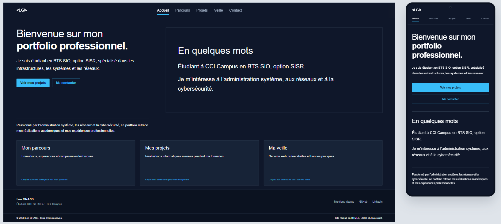
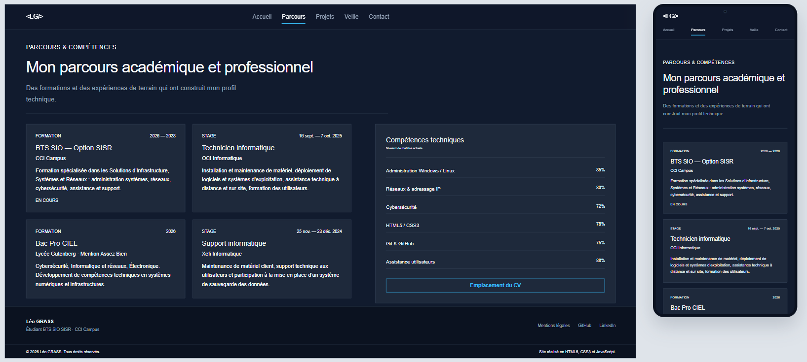
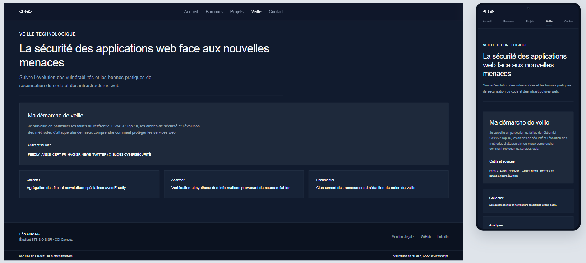
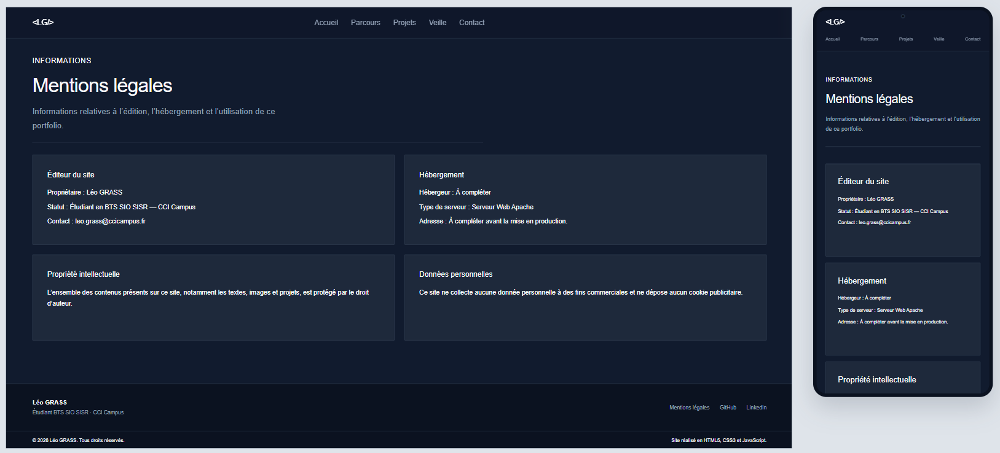

# Charte graphique du Portfolio

**Version** : 1.1  
**Auteur** : Léo GRASS  
**Date de création** : 22/12/2021 (Modèle F. SCHOSSIG)  
**Date de modification** : 27/11/2026  

**Sommaire :**

> [TOC]

## 1. Contexte du projet

Ce document constitue la charte graphique officielle pour la réalisation du site web portfolio de Léo GRASS, étudiant en BTS SIO (Services Informatiques aux Organisations) option SISR à CCI Campus.

L'objectif de ce portfolio est de présenter mon parcours de formation, mes compétences techniques, mes projets informatiques (dont les ateliers de professionnalisation) ainsi que ma veille technologique dans un cadre professionnel et moderne. Ce document sert de guide de référence pour le développement HTML5 / CSS3 afin de garantir une cohérence visuelle et ergonomique sur l'ensemble des pages.

## 2. Explication de l'identité visuelle

L'identité visuelle retenue pour ce portfolio s'appuie sur une esthétique sobre, axée sur le domaine du numérique, de l'administration système et de la cybersécurité.

Le choix s'est porté sur un style minimaliste et épuré (*Flat Design / Dark Mode*) afin d'assurer une lisibilité optimale des contenus techniques, réduire la fatigue visuelle et transmettre une image de rigueur, de modernité et de professionnalisme.

## 3. Éléments de déclinaison de cette identité visuelle

### 3.1. Couleurs

La palette de couleurs principale respecte les contrastes nécessaires à l'accessibilité web (normes WCAG) et est déclinée comme suit :

- **Couleur principale (Fond)** : `#0F172A` (Bleu nuit très sombre) — apporte du contraste et une ambiance moderne style console / éditeur de code.
- **Couleur secondaire (Cartes / Blocs)** : `#1E293B` (Bleu ardoise) — permet de structurer les sections et de hiérarchiser l'information.
- **Couleur d'accent (Boutons / Liens / Highlights)** : `#38BDF8` (Bleu cyan) — attire l'attention sur les éléments interactifs et les appels à l'action.
- **Couleur de texte principal** : `#F8FAFC` (Blanc cassé) — assure une excellente lisibilité sur fond sombre sans éblouissement.
- **Couleur de texte secondaire** : `#94A3B8` (Gris clair) — utilisé pour les sous-titres, dates et descriptions secondaires.

### 3.2. Typographie

- **Police principale (Titres et Corps de texte)** : `Inter`, sans-serif (Google Fonts) — choisie pour sa clarté et sa grande lisibilité sur écran.
- **Police secondaire (Code / Éléments techniques)** : `Fira Code`, monospace — utilisée pour l'affichage de balises, de commandes ou d'éléments techniques.
- **Tailles et hiérarchie** :
  - `h1` : 2.25rem (36px), bold
  - `h2` : 1.75rem (28px), semi-bold
  - `h3` : 1.25rem (20px), medium
  - `p` / `body` : 1rem (16px), regular (interligne `1.6`)

### 3.3. Logo, icônes et boutons

- **Logo** : Monogramme stylisé représentant les initiales `LG` encadrées de chevrons techniques `<LG/>`, intégré à gauche dans la barre de navigation.
- **Icônes** : Utilisation de la bibliothèque vectorielle SVG *Lucide Icons* (ex : icônes GitHub, LinkedIn, messagerie, terminal, menu mobile) pour garantir une netteté parfaite sur tous les écrans.
- **Boutons** :
  - *Bouton principal* : Fond cyan `#38BDF8`, texte sombre `#0F172A` en gras, coins légèrement arrondis (`border-radius: 6px`), padding `10px 20px`.
  - *Bouton secondaire* : Fond transparent avec bordure cyan `#38BDF8` (`1px solid`) et texte `#38BDF8`.
  - *Effets au survol (Hover)* : Légère variation de luminosité et transition fluide (`transition: all 0.3s ease`).

## 4. Maquettage responsive du site

Lien vers le projet Figma (Wireframes et Maquettes) : [Consulter la maquette sur Figma](https://www.figma.com/make/hBjc4mK2WWdRiYtkiCig6p/Sans-titre?code-node-id=0-6&p=f&t=APTp6L4z89ahYc9c-0&fullscreen=1)

Le portfolio est conçu selon une architecture multi-pages cohérente (6 pages HTML principales) regroupant l'Accueil, le Parcours, les Projets, les pages dédiées aux Ateliers 3 et 4, la Veille technologique et les Mentions légales. L'interface est pensée *Mobile-First* avec un point de rupture principal à `768px` (tablette/mobile) et `1024px` (ordinateur).

### 4.2. Maquettes haute fidélité — Version Desktop (1440px)

**Page d'accueil (`index.html`) :**

**Page Parcours (`parcours.html`) :**

**Page Projets (`projets.html`) :**

**Page Atelier de professionnalisation 3 (`atelier3.html`) :**

**Page Veille technologique (`veille.html`) :**

**Page Contact et Mentions légales (`mentions-legales.html`) :**

## 5. Logique de navigation dans le site

La navigation globale repose sur une barre de menu fixe (*header sticky*) accessible en permanence en haut de l'écran sur l'ensemble des pages :

1. **Menu principal (Desktop)** : Liens horizontaux vers `Accueil`, `Parcours`, `Projets`, `Veille`, `Contact`.

2. **Menu mobile (Hamburger)** : Menu escamotable déclenché en JavaScript pour les écrans < 768px. 

3. **Pied de page (Footer)** : Liens vers les mentions légales, le dépôt GitHub du projet et les réseaux professionnels (LinkedIn).

4. **Menu principal (Desktop)** : Liens horizontaux vers `Accueil`, `Parcours`, `Projets` (avec sous-menu déroulant vers `Atelier 3` et `Atelier 4`), `Veille` et `Contact`.

5. **Menu mobile (Hamburger)** : Pour les écrans inférieurs à `768px`, le menu se replie sous forme d'icône hamburger et s'ouvre en panneau vertical via JavaScript.

6. **Parcours utilisateur & Pied de page (Footer)** : Chaque page oriente le visiteur vers l'étape suivante grâce à des boutons d'appel à l'action clairs. Le pied de page rappelle le plan du site et propose les liens vers les mentions légales, le dépôt GitHub et le profil LinkedIn.
